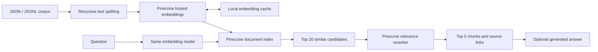

# TechAssist.ai RAG

The complete React/FastAPI employee chat application is documented in [APPLICATION.md](APPLICATION.md). Run `python scripts/run_app.py --build --mode ollama` after provisioning the local services.

A Python project that loads the supplied laptop troubleshooting JSON corpus, recursively splits text, creates vector embeddings with Pinecone Inference, stores the embeddings and source text in Pinecone, and retrieves relevant context for a question. An optional `ask` command generates a cited answer from that context.



## Quick start

Requires Python 3.10 or newer. Run commands from this project directory.

```bash
python3 -m venv .venv
source .venv/bin/activate
python -m pip install --only-binary=cryptography -e '.[dev]'
cp .env.example .env
```

Edit `.env` for non-secret settings only. Choose the Pinecone cloud and region your account supports before creating the index. Store credentials using hidden terminal prompts:

```bash
techassist secrets-store pinecone
```

Each command saves only an authenticated encrypted credential in `.secrets/<provider>.enc` inside the project. The wrapping key stays in your OS credential manager (macOS Keychain on this machine), outside the project. No key is echoed or passed as a command argument. An OS credential access prompt may appear. Do not paste API keys into chat or commit them. API usage and Pinecone resources can incur charges.

```bash
# Parse and chunk the corpus; does not call OpenAI or Pinecone.
techassist validate

# Create the configured Pinecone document index, or validate an existing one.
techassist init-index

# Embed and upsert the corpus. --wait checks that the IDs become readable.
techassist ingest --wait

# Retrieve text, cosine scores, document IDs, metadata and source URLs.
techassist query "My laptop gets hot and shuts down" --top-k 5

# Evaluate retrieval with the supplied synthetic answerable questions.
techassist evaluate --top-k 5
```

The project is installed in the local `.venv` in this workspace. The Pinecone credential has been imported from the authorized Apple Note and encrypted in `.secrets/pinecone.enc`, with its wrapping key in macOS Keychain. Ingestion, retrieval and evaluation use only that Pinecone credential. No OpenAI key is needed. Optional generated answers need a separate language-model credential. Offline tests simulate provider requests.

## Configuration

| Variable | Default | Purpose |
|---|---|---|
| `SECRETS_DIR` | `.secrets` | Encrypted project credentials; wrapping keys live in OS credential manager |
| `OPENAI_API_KEY` | optional process environment | Alternative to encrypted OpenAI credential; never put it in `.env` |
| `PINECONE_INDEX` | `techassist-laptops-hybrid` | Index name for 1,024-dimension vectors |
| `PINECONE_NAMESPACE` | `laptop-corpus-recursive-v2` | Isolated corpus partition |
| `PINECONE_CLOUD` | `aws` | Index deployment cloud |
| `PINECONE_REGION` | `us-east-1` | Index deployment region |
| `EMBEDDING_PROVIDER` | `pinecone` | Pinecone Inference; optional `openai` backend |
| `EMBEDDING_MODEL` | `llama-text-embed-v2` | Pinecone-hosted dense embedding model |
| `EMBEDDING_DIMENSIONS` | `1024` | Must match the Pinecone vector field |
| `RETRIEVAL_CANDIDATES` | `20` | Similarity candidates sent to the reranker, maximum 100 |
| `RERANK_MODEL` | `bge-reranker-v2-m3` | Pinecone-hosted relevance model |
| `CHAT_MODEL` | `gpt-4.1-mini` | Configurable Responses API model for `ask` |
| `CORPUS_PATH` | `knowledge_corpus/rag_chunks.jsonl` | Default knowledge source |
| `CHUNK_TOKENS` | `700` | Maximum tokens per generated chunk, 32–2000 |
| `CHUNK_OVERLAP` | `100` | Target overlap for recursive splitting; actual overlap follows boundaries |
| `BATCH_SIZE` | `32` | Embedding and upsert batch size, 1–32 |

Environment variables take precedence over non-secret `.env` settings in the current working directory. Plaintext API keys in `.env` are rejected; Pinecone always uses its encrypted credential. `validate` needs no keys and never opens the OS keyring. `init-index` only unlocks the Pinecone credential. The tokenizer downloads its public vocabulary on first use and then reads a local cache, so initial validation needs internet access even though it makes no provider API calls.

The Pinecone adapter uses the SDK 10.x Documents API with a schema containing a dense vector field named `embedding`. Text is explicitly embedded through Pinecone Inference before vector upload. This keeps the vectorization and storage stages visible; it is not an integrated-embedding index. Passages are embedded with `input_type=passage`, questions with `input_type=query`. Inputs that exceed the hosted model limit are rejected with `truncate=NONE`, rather than silently truncated. The recursive splitter measures cl100k tokens; the hosted model uses its own tokenizer, so an oversized input can still need a smaller chunk setting. Index creation enables deletion protection, and existing schema dimensions and cosine metric are checked before ingestion or querying. Legacy vector indexes and other document schemas are rejected with a configuration error; use a new index name rather than deleting an existing index.

## JSON input

The existing `rag_chunks.jsonl` and `laptop_knowledge.jsonl` are both accepted. Ingest just one representation to avoid duplicate knowledge. A `.json` file can contain an array of records or a single record; `.jsonl` files contain one record per line.

```json
{
  "id": "laptop-example-01",
  "document_id": "laptop-example",
  "text": "Symptoms, applicability, diagnostic steps, resolution, verification and escalation...",
  "metadata": {
    "title": "Example laptop issue",
    "category": "hardware",
    "platform": "Windows 11",
    "source_urls": ["https://example.com/support/article"]
  }
}
```

Each record requires a unique string `id` and non-empty `text`. `document_id` defaults to `id`. Metadata accepts strings, finite numbers, booleans and lists of strings; nested objects are rejected. Null metadata values are omitted. Source links, when supplied, must be lists of strings. Structured topic records can carry supported metadata fields at the top level instead of a `metadata` object.

```bash
techassist validate --file knowledge_corpus/laptop_knowledge.jsonl
techassist ingest --file path/to/your-corpus.json
```

The loader uses LangChain `RecursiveCharacterTextSplitter` with a tiktoken length function and this ordered separator hierarchy: paragraphs (`\n\n`), lines (`\n`), sentences (`. `), words (space), then characters. Chunk size is a hard token limit; overlap is a target and may be smaller at natural boundaries. Unicode characters remain intact. The supplied short topics stay whole, preserving verification and escalation. Longer text gets deterministic `::recursive-0001` part IDs. Each record carries strategy, chunk size, overlap and part metadata. The loader validates the complete input before cloud writes. It is an in-memory loader intended for small and medium corpora, not a streaming bulk-import system.

## Retrieval and answers

```bash
techassist query "Windows update fails with 0xC1900101" --category software
techassist query "No sound from speakers" --platform "Windows 11"
techassist query "Laptop fan noise" --min-score 0.3
```

Platform filtering matches the complete metadata value exactly. For example, `Windows 11` differs from `Dell laptops with Windows`; inspect `knowledge_corpus/topic_index.csv` before choosing a filter. Category filtering supports `hardware` and `software`. Every query also filters by embedding provider, model and dimensions so incompatible vector spaces are not mixed. A similarity score is not a confidence probability. No universal cutoff is assumed; calibrate `--min-score` using representative questions.

`query` returns evidence directly as JSON. `ask` passes that evidence to the generation model, instructs it to cite numbered records and preserve applicability, safety and escalation, and returns the answer alongside the labeled source records and URLs. If no hits survive filtering, it returns a clarification message without generating an answer. Relevance and citation correctness still need evaluation; prompt instructions alone do not guarantee grounded answers. Pinecone retrieves up to 20 candidates each using dense semantic search and BM25 on the full-text `text` field. Reciprocal rank fusion merges the lists and removes duplicates before reranking the top 20 to five. An explicitly configured index without a full-text field uses semantic search. The optional cosine cutoff excludes keyword-only candidates because they have no cosine score.

### Two-stage reranking

```bash
# Default: retrieve 20 similar candidates, rerank and return the best 5.
techassist query "My laptop overheats and shuts down"

# Increase candidate coverage while keeping five final chunks.
techassist query "My camera fails in video calls" --candidate-k 30 --top-k 5
```

`--candidate-k` overrides `RETRIEVAL_CANDIDATES` for `query`, `ask` and `evaluate`. It must be at least the final `--top-k` and no greater than 100. The default final count is five; fewer are returned when fewer candidates exist or pass the optional similarity cutoff. Category, platform, embedding-provider and model filters apply during vector retrieval. `--min-score` still applies to the original cosine score before reranking.

Each final chunk retains `score` (cosine similarity), adds `rerank_score` (query/document relevance), `similarity_rank` (position in the candidate list sent to reranking), `rerank_rank` (final position) and `rerank_model` (the model actually served). These scores have different scales and are not confidence probabilities. Results are mapped back using the reranker's original input index, preserving each chunk's text and source metadata. A reranking failure is reported rather than silently returning similarity-only results. No re-ingestion is needed.

The same encrypted Pinecone credential authenticates reranking, with no OpenAI key required. Reranking adds an inference call, latency and possible usage charges per query. Optional `ask` generation receives only the final reranked chunks; evaluation also uses this two-stage flow. Synthetic evaluation questions remain smoke checks rather than proof of improved accuracy.

## Optional answer generation and OpenAI embeddings

Retrieval needs no OpenAI key. To additionally generate prose answers, provision an OpenAI key and use `ask`:

```bash
techassist secrets-store openai
techassist ask "My laptop gets hot and shuts down" --top-k 5
```

Without that optional key, `ask` gives a configuration error before making any model calls; use `query` for ranked troubleshooting context and source links. To explicitly switch embedding providers, set `EMBEDDING_PROVIDER=openai`, `EMBEDDING_MODEL=text-embedding-3-small`, `EMBEDDING_DIMENSIONS=1536`, and use a separate matching index/namespace before re-ingestion. `text-embedding-3-large` is also supported. Do not compare vectors from different models.

## Updates, caching and failures

- Embeddings are cached in `.rag_cache/embeddings.sqlite3`, keyed by model, dimensions and exact text. Pinecone cache keys also include provider and passage/query input type. A rerun reuses cached embeddings and re-upserts records; text and metadata remain refreshable.
- Pinecone replaces an existing record with the same ID. Rerunning the same file therefore does not create duplicate IDs. Accepted batches persist if a later batch fails. Rerun ingestion to recover; there is no all-or-nothing transaction.
- Removed records and obsolete part IDs are not deleted automatically. Use a fresh namespace for a changed corpus snapshot or chunking configuration; validate it before switching queries. Old namespaces remain until you deliberately retire them in Pinecone.
- The default namespace is now `laptop-corpus-recursive-v2` to isolate this splitter from earlier fixed token windows. Existing `.env` files must be updated manually to that namespace before ingestion. The active default index is `techassist-laptops-hybrid`; the earlier 1,536-dimension `techassist-laptops` index is unused by this configuration and has not been deleted.
- Changing embedding models requires re-embedding into a fresh namespace; changing dimensions also requires an index with the matching schema. Use the same configuration for ingestion and querying.
- Pinecone writes become visible asynchronously. `--wait` confirms ID visibility, not that the latest version of an overwritten ID is already visible in every search. Allow propagation time before evaluation.
- SDK clients handle transient API retries. Credentials, schema and quota failures need their underlying cause fixed. CLI errors avoid printing request payloads or secrets. Inspect provider dashboards for detailed failures.

## Encrypted credential lifecycle

Fernet provides authenticated encryption, rather than encoding or obfuscation. The `.enc` envelope contains a format version, a non-secret random keyring record ID and ciphertext. The API key and provider name are inside the authenticated ciphertext. The independently generated wrapping key is stored only in an approved OS credential backend. File permissions are restricted to the current user where supported, and writes replace the old ciphertext atomically. `.secrets/` is also excluded from Git.

A copy of the project alone cannot decrypt the credentials. This also means another machine needs its own credential provisioning. Losing the OS keyring wrapping key requires entering the API key again; there is no project-local recovery key. The application decrypts only when making provider calls and necessarily holds the credential in process memory while authenticating. Encryption does not protect against someone who controls your logged-in account or process memory.

Supported backends are macOS Keychain, Windows Credential Locker, Linux Secret Service and KWallet. Plaintext file backends, fallback chains and unavailable keyrings fail closed. A headless deployment needs a supported unlocked OS secret service; no master-key file is placed beside the ciphertext. The same encrypted storage is available for OpenAI so no API keys need to be saved in `.env`.

To replace a credential, rerun `techassist secrets-store pinecone` or `techassist secrets-store openai`; the updated value is encrypted before it is written. If migrating from the earlier project, remove any API-key lines from `.env` before running the command. No command displays decrypted keys. `scripts/provision_pinecone_from_notes.py` is the narrowly scoped import helper used for the authorized Apple Note titled `Pinecone`; it captures the note in memory, selects a single identifiable Pinecone key, encrypts it and checks a decrypt round trip without printing the note or credential. Never add the encryption wrapping key to the repository or bundle it with the ciphertext.

## Try sample user queries

```bash
source .venv/bin/activate
python scripts/test_sample_queries.py
```

This runs six answerable paraphrased troubleshooting questions plus one printer question outside corpus coverage. It retrieves 20 candidates and reranks to five per question, then saves full chunks, source URLs, similarity scores and reranking scores to `reports/sample_query_results.json`. The small sample is a smoke test, not an accuracy benchmark. The printer example illustrates that nearest-neighbor retrieval can return unrelated evidence even when the corpus cannot answer the question.

For your own question:

```bash
techassist query "My MacBook shows a flashing question-mark folder" --candidate-k 20 --top-k 5
```

## Tests and reproducibility

```bash
python -m pytest -q
python knowledge_corpus/scripts/validate.py
```

Tests cover encrypted storage, absent wrapping keys, ciphertext tampering, insecure backend rejection, plaintext configuration rejection, real corpus loading, invalid input, recursive boundaries, Unicode, embedding cache isolation and ordering, dimensions, namespace and filter consistency, partial acknowledgements, candidate selection, reranking index mapping and failure handling, answer evidence, and SDK request/response handling. Provider calls are simulated; no API keys or paid calls are required. A first tokenizer use may need its public vocabulary download.

On this machine the Anaconda Python 3.13 native `readline` module crashes when pytest loads its capture/debugging plugins. The suite was run successfully with those plugins disabled:

```bash
python -m pytest -p no:capture -p no:debugging -q
```

`requirements.lock` records the tested environment's exact package versions. For reproduction on a compatible platform, install with `python -m pip install -r requirements.lock`, then `python -m pip install --no-deps -e .`. The package's supported version ranges live in `pyproject.toml`.

`techassist evaluate` reports mean recall@k and mean reciprocal rank over unique document IDs, plus per-question retrieval results. The supplied questions are synthetic smoke checks, not an independent accuracy benchmark. The boundary questions require separate manual assessment and are not accepted by the numeric evaluator unless they have explicit expected IDs.

## Project submission

- [Project presentation](../submission/TechAssist_Project_Submission.pptx)
- [Executive brief](../submission/TechAssist_Executive_Brief.docx)

These documents describe the hosted Replit implementation, verified Wi-Fi workflow, and remaining limitations as of 9 November 2026.

## Source documentation

Implementation follows [LangChain recursive splitting](https://reference.langchain.com/python/langchain-text-splitters/character/RecursiveCharacterTextSplitter), [Fernet authenticated encryption](https://cryptography.io/en/stable/fernet/), [OS keyring storage](https://keyring.readthedocs.io/en/stable/), [OpenAI vector embeddings](https://developers.openai.com/api/docs/guides/embeddings), [OpenAI text generation](https://developers.openai.com/api/docs/guides/text), [Pinecone hosted embedding inference](https://sdk.pinecone.io/python/how-to/inference/embeddings.html), [Pinecone document schemas and upserts](https://sdk.pinecone.io/python/how-to/documents/schema-and-upsert.html), and [Pinecone document search](https://sdk.pinecone.io/python/how-to/documents/search.html), and [Pinecone reranking](https://sdk.pinecone.io/python/how-to/inference/reranking.html).

The knowledge content's evidence limitations and original source register remain in `knowledge_corpus/README.md` and `knowledge_corpus/sources.json`.
